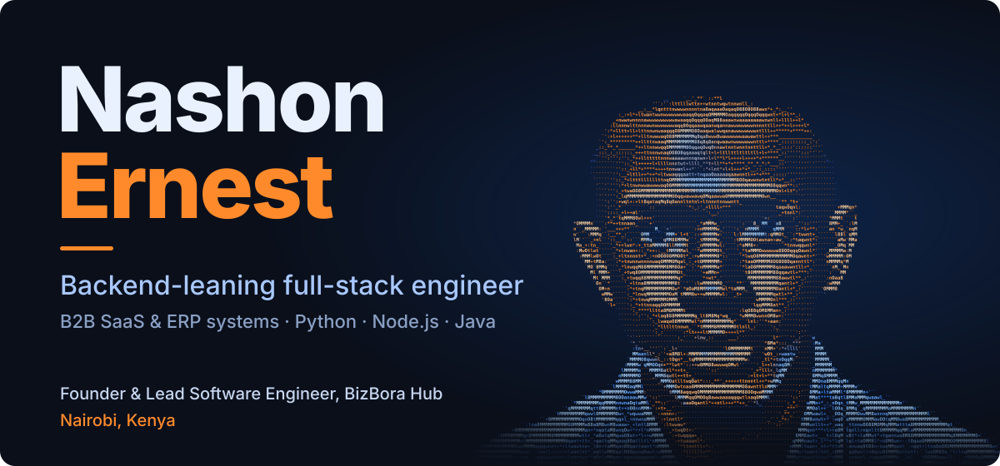

  

**Backend-Leaning Full-Stack Engineer | B2B SaaS & ERP Systems | Python, Node.js, Java**

Founding engineer running two live B2B SaaS/ERP platforms end to end, from database schema to production. 4+ years building and operating backend systems: REST APIs, multi-tenant architecture, PostgreSQL/MongoDB data modeling, and payment integrations (M-Pesa, Stripe) built so a retried request can't double-charge anyone.

- **Now:** building **[KaziFlow](https://kaziflow.bizbora.com)** and **[BizBora](https://mini.bizbora.com)** as Founder & Lead Software Engineer at [BizBora Hub](https://bizbora.com)
- **Before:** Founding Software Engineer at Axesoft Ltd, with 15+ production systems delivered for external clients
- **Next:** extending production observability with Prometheus, Grafana, Loki, and OpenTelemetry

## Featured Projects

| Project | What it does | Built with |
| :-- | :-- | :-- |
| **[KaziFlow](https://kaziflow.bizbora.com)** Production B2B SaaS | Backend for a CRM, invoicing, and accounting platform used by 8 businesses. Built the REST APIs, PostgreSQL schema, and Redis caching; deployed through Git-based CI/CD. | `FastAPI` `PostgreSQL` `Redis` `Docker` `Northflank` |
| **[BizBora Mini](https://mini.bizbora.com)** Multi-tenant cloud ERP | Tenant-aware inventory, sales, procurement, and accounting for 5 businesses across 8 stores, with tenant-level data isolation on shared infrastructure. | `Next.js` `Express` `MongoDB` |
| **[UremboApp](https://uremboapp.com)** Salon management platform | Booking, staff, and customer management with automated staff allocation to prevent scheduling conflicts, plus a SOAP-based SMS gateway for booking confirmations. | `Django` `PostgreSQL` `Next.js` |

## Tech Stack

**Backend** 

**Frontend and mobile** 

**Data** 

**Infrastructure and observability** 

## GitHub Stats

  
  

